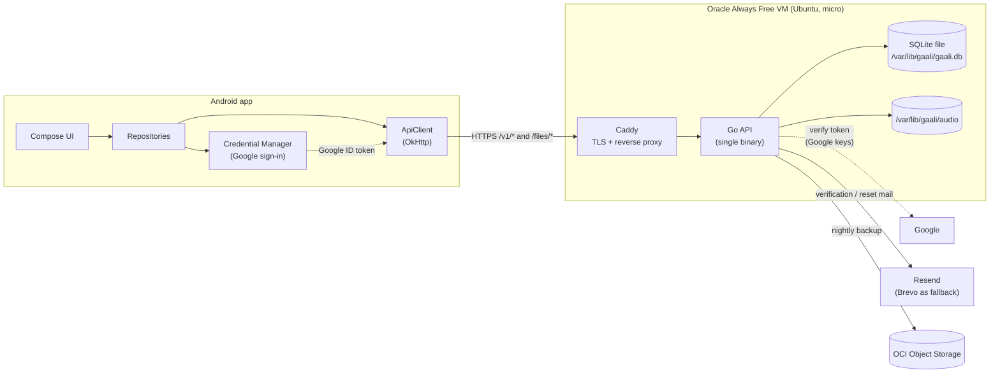
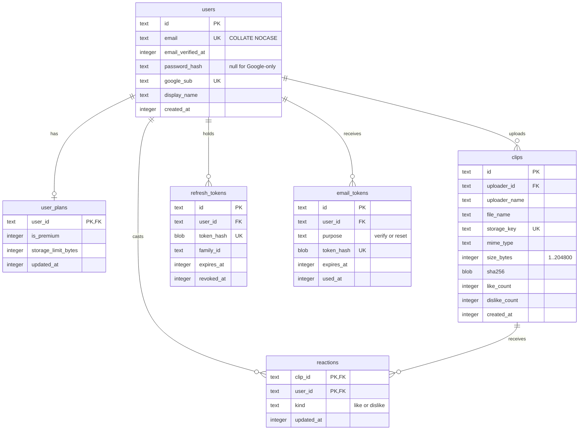
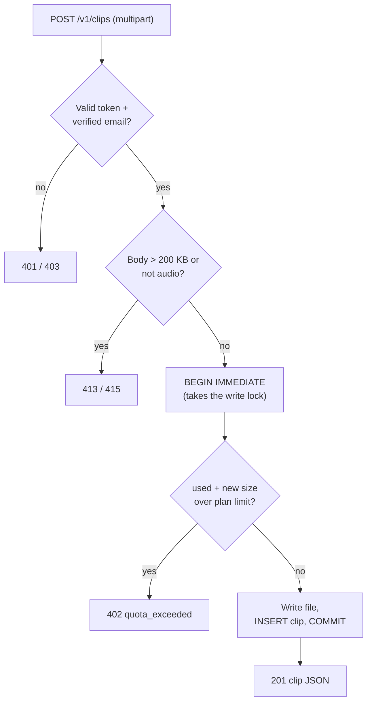
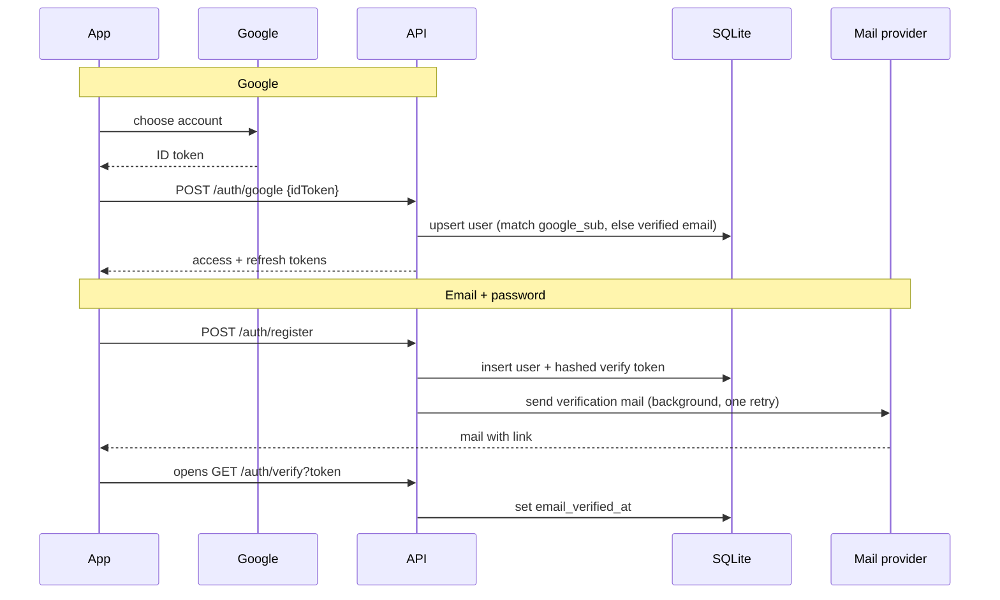

# Gaali Finder — backend and hosting

The app talks to one small API, hosted on an Oracle Cloud Always Free VM. Everything it uses is
free with no expiry. Live at <https://api.aniruddha81.tech>.

## Architecture



One VM, one API process (SQLite runs inside it) and Caddy beside it. No queues, no containers.

| Concern | Choice | Why |
| --- | --- | --- |
| API | Go, standard library `net/http`; `modernc.org/sqlite` (pure Go), argon2, `golang-jwt` | One static binary, nothing to install on the VM |
| Database | SQLite, WAL mode | Tiny data, one process; real constraints, triggers, transactional quota check |
| Audio | VM disk, served by the API with `immutable` caching | Free block storage is plentiful; Object Storage request limits are small, so it is backups only |
| Sign-in | Google (Credential Manager → ID token verified by the API) and email + password (argon2id) | Everything lives in one `users` table; Firebase is only used for analytics and push |
| Mail | Resend, with Brevo as an automatic fallback | Resend leaves links untouched, which helps inbox placement |
| TLS | Caddy with Let's Encrypt | Free and automatic |

## Free-forever ledger

| Piece | Free allowance | In use |
| --- | --- | --- |
| Oracle compute | 2× `VM.Standard.E2.1.Micro` (1/8 OCPU, 1 GB) | 1 (`gaali-api`), 2 GB swapfile |
| Boot volume | 200 GB total | 50 GB (the minimum) |
| Egress | 10 TB / month | tiny |
| Object Storage | about 20 GB | backups only |
| Budget alert | free | $1 monthly budget, any charge emails you |
| Resend | 3,000 mails / month, 100 / day | verification and reset mails |
| Brevo | 300 mails / day | fallback only |
| Firebase Spark | FCM + Analytics | existing; never upgrade to Blaze |
| Google OAuth | free | one Web client, two Android clients |
| Not free | the domain `aniruddha81.tech` | renewal is yours |

Ways it could still cost money or break:

1. **Upgrading the Oracle account to Pay-As-You-Go**, or creating anything not marked Always Free
   eligible. The $1 budget alert is the tripwire.
2. **Idle reclamation.** Oracle may reclaim Always Free compute it judges idle. Mitigation: nightly
   off-VM backups and a cloud-init file that rebuilds the whole server.
3. **Capacity.** A1 launches in Mumbai were throttled, which is why the VM is the micro shape.
   `SHAPE=a1 infra/provision.sh` tries an A1 (1 OCPU, 6 GB) instead.

## Database

Plain numbered SQL files in `server/migrations/` are applied in order on start and recorded in
`schema_migrations`. A migration whose first line is `-- migrate:foreign-keys-off` runs with
foreign-key enforcement off and is checked for broken keys before it commits (needed to rebuild a
table other tables point at). Types: ids are random-hex `TEXT`, timestamps are `INTEGER` unix
milliseconds, hashes are `BLOB`.



Rules the database enforces itself:

- `clips.size_bytes` has `CHECK (size_bytes BETWEEN 1 AND 204800)`, the per-file cap.
- `reactions` is keyed by `(clip_id, user_id)`: one reaction per user per clip, and like and dislike
  are mutually exclusive because they are one row with a `kind`.
- Triggers on `reactions` recount a clip's likes and dislikes in the same transaction. SQLite has
  one writer at a time, so concurrent votes serialise and none is lost.
- Tokens (refresh, verify, reset) are stored only as SHA-256 hashes.

**Upload quota** is enforced before anything is written:



The size is measured from the bytes received. Free limit 10 MB; a premium user's limit comes from
`user_plans.storage_limit_bytes` (0 means the 100 MB default). To make someone premium:

```sh
ssh gaali 'sudo sqlite3 /var/lib/gaali/gaali.db "INSERT INTO user_plans (user_id, is_premium, storage_limit_bytes, updated_at) SELECT id, 1, 0, strftime(\"%s\",\"now\")*1000 FROM users WHERE email=\"someone@example.com\" ON CONFLICT(user_id) DO UPDATE SET is_premium=1;"'
```

## API (`/v1`, JSON)

| Method + path | Auth | Purpose |
| --- | --- | --- |
| `POST /auth/register` | – | email, password (10–128 chars), displayName; sends a verification mail |
| `POST /auth/login` | – | email + password → access + refresh tokens |
| `POST /auth/google` | – | Google ID token (signature, audience, expiry, verified email checked) |
| `POST /auth/refresh` | refresh token | rotates it; replaying an old one revokes the whole session family |
| `POST /auth/logout` | refresh token | revokes it |
| `POST /auth/resend-verification` | access | rate limited |
| `GET /auth/verify?token=` | link | "Email verified" page |
| `POST /auth/forgot` | – | always 202 (no account enumeration); mails a reset link |
| `GET/POST /auth/reset?token=` | link | form to set a new password; revokes all sessions |
| `GET /me`, `GET /me/reactions` | access | user, plan, usage; the user's reactions |
| `GET /clips?cursor=` | – | newest first, cursor-paginated |
| `POST /clips`, `DELETE /clips/:id` | access | upload; delete (uploader only) |
| `PUT /clips/:id/reaction` | access | `{kind: like\|dislike\|none}` → new counts |
| `GET /files/:key` | – | audio bytes, range requests, `immutable` |
| `GET /`, `/privacy`, `/terms`, `/healthz` | – | public pages and liveness |

Errors are `{"error": "<code>", "message": "…"}` with stable codes. Security: argon2id; per-IP and
per-email rate limits on `/auth/*`; verify links valid 24 h and reset links 1 h, both single use;
access token 15 min; refresh token 1 year with rotation; HTTPS only; secrets only in a root-owned
env file on the VM.



## Infrastructure (`infra/`)

| File | What it does |
| --- | --- |
| `provision.sh` | Creates the $1 budget alert, compartment `gaali`, VCN (80, 443 and SSH open to all; sshd is key-only and fail2ban is on), the VM, the `gaali-backups` bucket and the instance-principal policy. Safe to re-run |
| `cloud-init.yaml` | First-boot setup: Caddy, rclone, firewall (ufw + fail2ban), unattended upgrades, systemd units, swap, env files |
| `deploy.sh` | Runs the tests, cross-compiles for the VM's architecture, uploads the one binary, restarts, checks health |

Rebuild from nothing: `DOMAIN=api.aniruddha81.tech ALERT_EMAIL=<you> infra/provision.sh`,
point the DNS record at the printed IP, fill in `/etc/gaali/api.env`, then `infra/deploy.sh ubuntu@<ip>`.
SSH is `ssh gaali` (alias in `~/.ssh/config`) and works from any address, so a changing home IP is fine.

Secrets live only in `/etc/gaali/api.env` on the VM (`JWT_SECRET`, `GOOGLE_WEB_CLIENT_ID`,
`RESEND_API_KEY`, `BREVO_API_KEY`, `MAIL_FROM`, `MAIL_FROM_NAME`, `MAIL_REPLY_TO`).
Logs: `ssh gaali 'sudo journalctl -u gaali-api -f'`.

**Backups.** A systemd timer runs nightly at 03:30 UTC: a consistent `sqlite3 .backup` plus the audio
folder go to the `gaali-backups` bucket through the VM's own identity (no stored keys); 14 days of
database copies are kept. Restore on a fresh VM with the service stopped:

```sh
rclone copyto oos:gaali-backups/db/gaali-YYYY-MM-DD.db /var/lib/gaali/gaali.db
rclone copy   oos:gaali-backups/audio /var/lib/gaali/audio
```

The restore was tested: a copy came back with every row and a clean integrity check.

## Auto-deploy (GitHub Actions)

Pushing to the `release` branch deploys the server and web pages. The workflow
(`.github/workflows/deploy-web.yml`) refuses any commit that is not already on `main`, runs vet and
tests, builds the Linux binaries and publishes them as the `web-latest` release. The VM never accepts
SSH from GitHub, so it pulls instead: `gaali-update.timer` checks every minute, verifies the
checksum, installs, restarts, and rolls back (remembering the bad build) if `/healthz` fails.
After publishing, the workflow also SSHes in with a dedicated deploy key to run the updater at once
instead of waiting for the timer. That key's line in `authorized_keys` is locked to one forced
command (`sudo /usr/local/bin/gaali-update`, no shell, no port forwarding), so a leaked key can do
nothing but re-run the updater. Repository secrets: `DEPLOY_SSH_KEY`, `DEPLOY_KNOWN_HOSTS`,
`DEPLOY_HOST`, `DEPLOY_USER`. Expect a deploy about 2-3 minutes after the push.

```sh
git push origin main:release     # ship what is on main
sudo journalctl -u gaali-update -n 20   # on the VM: what the updater did
```

Set up once per VM with `infra/enable-auto-deploy.sh ubuntu@<ip>` (installs the updater, its timer
and the locked deploy key). Manual `infra/deploy.sh` still
works. Also protect `release` in GitHub (Settings, Branches) so only you can push to it: whoever can
push there can ship code to the server.

## Admin console

`https://api.aniruddha81.tech/admin` is a live dashboard for the server and database: request rate,
errors and latency, DB ping, CPU/memory/disk, Go runtime, per-table rows and sizes, WAL size,
connection pool, users and clips, recent requests and the server log. It refreshes every 2-15 s and
keeps the last hour in memory (a restart empties it).

Access: set `ADMIN_EMAILS=you@example.com` (comma-separated) in `/etc/gaali/api.env` and restart. Sign
in on the page with that account's e-mail and password; the e-mail must be verified. A Google-only
account has no password, so use "Forgot password" in the app once to set one. With the variable
empty nobody can use the console, and the page itself shows nothing without a valid admin token.

## Email

The API sends two mails, verification and password reset, in the background with one retry, capped
at 250 a day. It tries **Resend** first and falls back to **Brevo** if Resend refuses.

Why Resend first: Brevo's free plan rewrites every link through its shared tracking domain and
cannot turn that off, which pushed the first verification mail into Gmail's Spam. Through Resend a
verification mail reached the inbox of two different Gmail accounts with the link on our own
domain. A brand-new sending domain can still be treated cautiously at first.

DNS records for the sender (all in Cloudflare, DNS only):

| Purpose | Records |
| --- | --- |
| Resend | `TXT resend._domainkey`, `MX send` → `feedback-smtp.ap-northeast-1.amazonses.com` (10), `TXT send` (`v=spf1 include:amazonses.com ~all`), `CNAME rsend` → `send.forge.rmta.net` |
| Brevo | brevo-code `TXT`, `CNAME brevo1._domainkey`, `CNAME brevo2._domainkey`, DMARC `TXT _dmarc` |
| API | `A api` → the VM's IP |

Do not set a Reply-To on a freemail address: mail sent from your own domain with a Gmail Reply-To
cost 2.5 spam points in testing.

## Android app

`local.properties` (git-ignored) needs:

```properties
API_BASE_URL=https://api.aniruddha81.tech
GOOGLE_WEB_CLIENT_ID=<the Web client id from the gaali-finder Google Cloud project>
```

Google side: one Web OAuth client plus two Android clients (debug and release SHA-1) in the
`gaali-finder` project; the consent screen is published to production with the privacy and terms
pages served by the API. The refresh token is stored encrypted with an Android Keystore key. Debug
builds may use plain HTTP to `10.0.2.2` for a local API.

## Still to do

- Try the over-quota upload path on a device.
- Build a signed release APK and bump the version.
