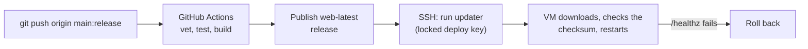

# 🎵 GaaliFinderV2  

GaaliFinderV2 is an **audio clip sharing app** for meme lovers to share viral meme audio clips with friends via social media. The app includes a shared library of trending audio clips from viral memes, and users can also add their own clips locally or upload them for everyone.  

## 🚀 Features  
- 🎶 **Trending Meme Audio Clips** – Access viral meme sounds.  
- 📂 **Local Audio Import** – Add personal audio clips stored locally.  
- ☁️ **Shared Library** – Sign in with Google or email and upload clips for everyone, like or dislike clips.  
- 🔄 **Automatic Updates** – New clips from the shared library are synced automatically.  
- 📤 **Easy Sharing** – Share clips via social media apps.  
- 🔍 **Search & Organize** – Find clips quickly with search functionality.  
- 🗑️ **Manage Files** – Delete unwanted clips from the app.  
- ✏️ **Rename Files** – Rename audio files by double-clicking.
- 🔔 **Notification Updates** – Get notifications when new files are added.

## 🧱 What's in this repo

| Path | What it is |
| --- | --- |
| [`app/`](app/) | The Android app (Kotlin, Jetpack Compose, Room, Hilt) |
| [`server/`](server/) | The API and web pages: Go + SQLite, one binary |
| [`infra/`](infra/) | Scripts to create and deploy the server on Oracle Cloud Always Free |
| [`.github/workflows/`](.github/workflows/) | Auto-deploy of the server (see below) |
| [`ARCHITECTURE.md`](ARCHITECTURE.md) | How the app is layered |
| [`DEPLOYMENT.md`](DEPLOYMENT.md) | How the server is hosted, backed up and deployed |

## 📌 Setup Instructions  

### 1️⃣ Clone the Repository  
```sh
git clone https://github.com/aniruddha81/Gaali-Finder-v2.git
cd Gaali-Finder-v2
```

### 2️⃣ Point the app at the API
Add these to `local.properties` (git-ignored):
```properties
API_BASE_URL=https://api.example.com
GOOGLE_WEB_CLIENT_ID=your_google_oauth_web_client_id
```
The API itself lives in [`server/`](server/). See [`DEPLOYMENT.md`](DEPLOYMENT.md) for how it is hosted.

### 3️⃣ Add `google-services.json` File
Download the `google-services.json` file from your Firebase project and place it in the `app` directory of this project.

### 4️⃣ Build & Run the App
Open the project in Android Studio, connect your device/emulator, and run the app.

**Release build.** Bump `versionCode` and `versionName` in [`app/build.gradle.kts`](app/build.gradle.kts), then use *Build → Generate Signed Bundle / APK* with your keystore. Google sign-in only works in a release build if that keystore's SHA-1 is registered on an **Android** OAuth client (package `com.aniruddha81.gaalifinderv2`) in the Google Cloud project; get it with `keytool -list -v -keystore <your.jks> -alias <alias>`.

## 📌 How It Works
- **Shared Library** – Signed-in users (Google, or email and password with a verified address) upload clips to the shared library. Each file may be up to 200 KB; free accounts get 10 MB in total.
- **Local Cache** – Clips are downloaded on first play and kept on the device so they work offline.
- **Auto-Sync** – New clips from anyone appear in everyone's app on the next sync.

## 🖥️ Server

The API (auth, clips, reactions, audio files) is a single Go binary with a SQLite database, running on one Oracle Cloud VM behind Caddy.

```sh
cd server
go test ./...        # run the tests
```

To run it locally, set at least `JWT_SECRET` (32+ characters) and start it with `go run .`; see [`server/.env.example`](server/.env.example) for every setting.

### Admin console

`/admin` on the API's domain is a live dashboard for the server and database, with write access to the data. It is available only to the e-mails listed in `ADMIN_EMAILS`, who sign in with their normal app account.

- **Overview, Database, Requests, Logs** – request rate, errors and latency, DB ping, CPU/memory/disk, Go runtime, table sizes, connection pool, recent requests and the server log, refreshed every few seconds.
- **Users & content** – sign-ups, clips, premium users, active sessions, mail quota.
- **Data** – browse, search, edit, add and delete rows in every table; set a user's password or sign them out; deleting clips or users also removes their audio files.
- **SQL** – run one statement as a dry run (rolled back) or save it.
- **Audit** – every write is recorded in the `admin_audit` table with the previous values.

Details and safeguards are in [`DEPLOYMENT.md`](DEPLOYMENT.md#admin-console).

### Deploying

Pushing to the `release` branch deploys the server. The workflow only accepts commits that are already on `main`.



```sh
git push origin main:release          # ship what is on main
```

The VM also checks for a new build every minute, so a deploy lands even if the SSH step is skipped. `infra/deploy.sh` still works for a manual deploy. Setup and secrets are described in [`DEPLOYMENT.md`](DEPLOYMENT.md#auto-deploy-github-actions).
